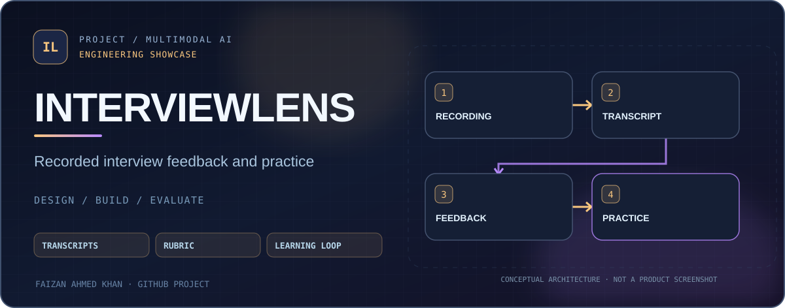
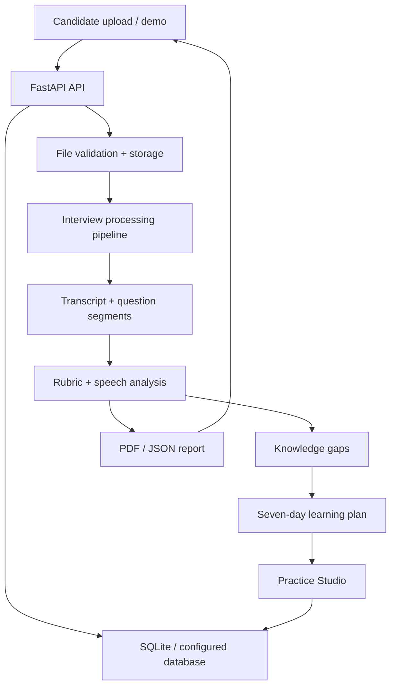

<div align="center">
  <a href="https://github.com/FaizanAKhan786/interviewlens-ai"></a>
  <br />


# InterviewLens AI
### Turn recorded interviews into focused practice

**Recorded interview analysis · Structured feedback · Speech metrics · Study plans**


[Quick start](#quick-start) · [Architecture](#architecture) · [Coaching workflow](#coaching-workflow) · [Technical architecture](docs/architecture/overview.md)

</div>

## Overview

InterviewLens AI is a **portfolio prototype for reviewing previously recorded technical interviews**. It organizes recordings, transcripts, rubric-based feedback, speaking-pattern observations, knowledge gaps and a personalized study plan into one interface.

The included **local AI provider** is a deterministic demonstration path; don't confuse its outputs with independent proof of model-based evaluation. Optional provider adapters exist for external services and require configuration.

| Area | What the app provides |
| --- | --- |
| Ingestion | Recorded video/audio upload and consent check |
| Review | Time-linked transcript and question/answer workspace |
| Coaching | Technical rubric, omissions and follow-up questions |
| Communication | Speaking pace and filler-word feedback |
| Learning loop | Seven-day study roadmap and practice attempts |
| Export | PDF and JSON reporting |
| API | FastAPI routes for auth, interviews, transcripts, learning and practice |

## Architecture



The code includes provider abstractions and a pipeline intended for integration with actual transcription/analysis services. Capability and quality vary by configured provider.

## Quick start

**Requirements:** Python 3.11+ and pip. Local development defaults to SQLite.

```bash
git clone https://github.com/FaizanAKhan786/interviewlens-ai.git
cd interviewlens-ai
python -m venv .venv
source .venv/bin/activate    # Windows: .venv\Scripts\activate
pip install -r requirements.txt
python -m uvicorn services.api.main:app --host 127.0.0.1 --port 8000 --reload
```

Open [the local app](http://127.0.0.1:8000), or check [API docs](http://127.0.0.1:8000/docs) and [health](http://127.0.0.1:8000/health). Choose **Instant Demo** in the UI to explore the seeded feedback workflow without supplying a real recording.

Optional settings are documented in [`.env.example`](.env.example). This code reads environment variables from the running process; do not assume that creating a `.env` file alone configures the app. Set `SECRET_KEY` securely before deploying beyond local development.

## Coaching workflow

```text
Interview question → specific knowledge gap → why it matters
        → study task → targeted practice → revised feedback
```

Rubric categories include relevance, factual accuracy, completeness, clarity, structure and depth. Reported posture/gaze observations, where available, are descriptive interface cues **not hiring competence indicators**.

## Tests and project structure

```bash
python -m pytest tests/test_backend.py -c pytest.ini --rootdir . -v
```

- [`services/api/`](services/api/): FastAPI application and provider interfaces
- [`services/worker/`](services/worker/): background processing code
- [`docs/architecture/overview.md`](docs/architecture/overview.md): detailed architecture
- [`docs/privacy/`](docs/privacy/): privacy and retention guidance
- [`tests/`](tests/): automated checks

**Scope:** This is not an applicant-screening or hiring recommendation engine. Obtain the consent of everyone recorded, avoid uploading sensitive personal information into an unreviewed environment, and validate any model feedback independently.

## Verification & benchmark protocol

[Read the reproducible test and evaluation guide](docs/QUALITY.md). It documents the current automated checks, commands for model-dependent evaluations, and what results **do not** establish.

[Issues](https://github.com/FaizanAKhan786/interviewlens-ai/issues) · [GitHub profile](https://github.com/FaizanAKhan786)
